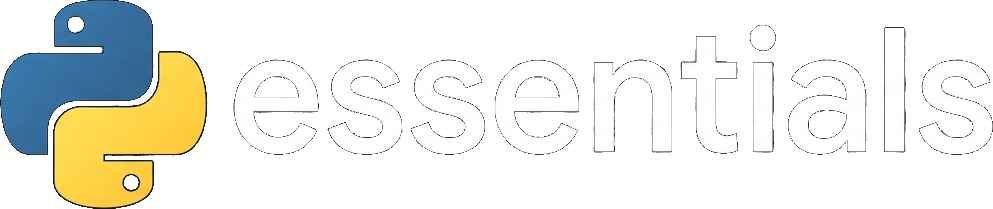

<div align="center">



# pyessentials - Library Meta-Installer for Python

</div>

## 📋 Table of Contents / Indice

[🇬🇧 English](#-english-guide) | [🇪🇸 Español](#-guía-en-español)

**English Content:**

- [📖 Overview](#-overview)
- [✨ Features](#-features)
- [🛠️ Prerequisites](#-prerequisites)
- [🚀 Usage](#-usage)
- [🖥️ Interactive Menu](#️-interactive-menu)
- [📌 Available Arguments](#-available-arguments)
- [🎯 Quick Example](#-quick-example)

  

**Contenido en Español:**
- [📖 Descripción general](#-descripción-general)
- [✨ Características](#-caracteristicas)
- [🛠️ Requisitos previos](#-requisitos-previos)
- [🚀 Uso](#-uso)
- [🖥️ Menú Interactivo](#️-menú-interactivo)
- [📌 Argumentos Disponibles](#-argumentos-disponibles)
- [🎯 Ejemplo](#-ejemplo)

---

## 🇬🇧 English Guide

## 📖 Overview

**pyessentials** is a command-line utility designed to simplify your Python development workflow. It allows you to bulk-install groups of libraries and APIs organized into specialized development domains ("programming campuses"), adapting automatically to your active operating system.


## ✨ Features

*   **Modular Installation:** Choose the exact category of libraries you need based on your study field or project target.
*   **Interactive Menu:** Run the script with no arguments to get a numbered menu of every campus, then drill into a category to see its full package list.
*   **Individual Package Selection:** Inside a category you can install a single library, a custom set (e.g. `1,3,5`), or the whole category with `0`, giving you full control instead of a forced bulk install.
*   **Cross-Platform Support:** Automatically detects whether you are running on Windows (using `pip`) or Linux/macOS (using `pip3`).
*   **Safe & Optimized Execution:** Leverages structural list unpacking using the `*` operator to feed external subprocess arguments reliably.
*   **Sleek Terminal Output:** Features a distinctive ASCII banner and native interactive hyperlinks using ANSI escape sequences directly in the shell.


## 🛠️ Prerequisites

*   **Python 3.x** installed and configured on your operating system.
*   The **pip** or **pip3** package manager added correctly to your system's environment variables (`PATH`).
*   Using a virtual environment (venv) is highly recommended to avoid package conflicts.


## 🚀 Usage

To execute the meta-installer, open a terminal window in the directory where the script is located and pass the flag corresponding to your desired category.

### Basic Syntax

**On Windows Systems:**
```bash
python pyessentials.py [Argument]
```

## 🇪🇸 Guía en Español

## 📖 Descripción general

**pyessentials** es una herramienta de línea de comandos diseñada para simplificar la configuración de tu entorno de desarrollo en Python. Permite instalar de forma masiva grupos de librerías y APIs organizadas por categorías especializadas («campus de programación»), adaptándose automáticamente al sistema operativo detectado.

## ✨ Características

*   **Instalación modular:** Elige la categoría específica de librerías que necesites según tu área de estudio o el objetivo de tu proyecto.
*   **Menú interactivo:** Ejecuta el script sin argumentos para acceder a un menú numerado de todos los «campus»; luego, explora una categoría para ver su lista completa de paquetes.
*   **Selección individual de paquetes:** Dentro de una categoría, puedes instalar una única librería, un conjunto personalizado (por ejemplo, `1,3,5`) o la categoría completa seleccionando `0`, lo que te brinda un control total en lugar de una instalación masiva obligatoria.
*   **Compatibilidad multiplataforma:** Detecta automáticamente si estás trabajando en Windows (usando `pip`) o en Linux/macOS (usando `pip3`).
*   **Ejecución segura y optimizada:** Utiliza el desempaquetado de listas mediante el operador `*` para pasar argumentos a subprocesos externos de manera fiable.
*   **Salida en terminal elegante:** Incluye un distintivo banner en formato ASCII y enlaces interactivos nativos mediante secuencias de escape ANSI, directamente en la consola.


## 🛠️ Requisitos previos

*   **Python 3.x** instalado y configurado en tu sistema operativo.
*   El gestor de paquetes **pip** o **pip3** correctamente añadido a las variables de entorno (`PATH`) de tu sistema.
*   Se recomienda encarecidamente el uso de un entorno virtual (venv) para evitar conflictos entre paquetes.


## 🚀 Uso

Para ejecutar el meta-instalador, abre una ventana de terminal en el directorio donde se encuentra el script y utiliza el argumento correspondiente a la categoría que desees.

### Sintaxis básica

**En sistemas Windows:**
```bash
python pyessentials.py [Argumento]
```
